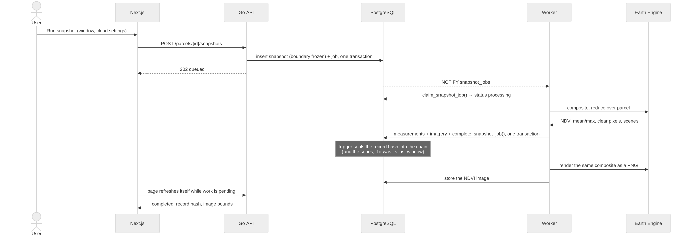

# Architecture

Diagrams are SVG images rendered from the Mermaid sources in [diagrams/](diagrams/). Edit a `.mmd` file, then re-render it (e.g. at mermaid.live) and replace the `.svg`.

## How the parts talk to each other

The Go API and the Python worker never call each other. PostgreSQL is the only link between
them, so either can be down or redeployed without breaking the other.



<sub>Source: [architecture-1.mmd](diagrams/architecture-1.mmd)</sub>

## Core concepts

Groundwork relies on a strict, auditable geospatial database using PostgreSQL and the PostGIS extension.

- **Parcels**: Physical land boundaries owned by one user, stored as `GEOMETRY(MULTIPOLYGON, 4326)` so one parcel can have several pieces (e.g. split by a river or road). A single polygon is stored as a one-piece MultiPolygon. The system automatically calculates the exact real-world area (in hectares, summed over all pieces) using PostGIS functions that factor in the curvature of the Earth. Invalid boundaries (self-intersecting, overlapping pieces) are rejected. Parcels can be edited.
- **Methodologies**: Immutable, version-controlled specifications that define *how* a satellite measurement is calculated (e.g., which satellite bands to use, cloud masking thresholds, and how to composite multiple images).
- **Snapshots**: A single measurement run. It acts as the bridge connecting a specific Parcel, a specific Methodology, and a specific Date Range. A snapshot stores its own copy of the parcel geometry (plus a hash of it), so editing a parcel never changes past snapshots.
- **Measurements**: The actual computed index values (e.g., the mean NDVI value of the parcel).
- **Imagery Sources**: A permanent audit trail logging the exact raw satellite imagery used to calculate a specific Snapshot.
- **Users**: Accounts with a role, either `auditor` (verifies claims) or `asset_holder` (registers parcels).

Database triggers enforce the audit guarantees: snapshot inputs can never change, completed snapshots cannot be deleted or reopened, and their measurements and imagery records are frozen.

## Snapshot pipeline

### Design principles

1. **Snapshots are evidence, not cache.** A completed snapshot is never recomputed or overwritten. A better method means a new methodology version and new snapshots.
2. **A methodology is a versioned spec.** A methodology row is immutable; the worker's registry maps its slug to the code that computes it.
3. **The database is the only link between the services.** Go requests work and serves results; Python does all calculations. Neither calls the other.
4. **Everything needed to reproduce a result is stored with it**: inputs, parameters, methodology version, and every source with the version the provider reported when it was read (Earth Engine's `system:version`), the methodology's manifest hash and the worker's code version.
5. **The schema is the contract.** Schema changes go through `backend/go-api/migrations` only, in backward-compatible steps (add, update both services, then remove).

### Flow

```text
Frontend ──▶ Go API: POST /parcels/{id}/snapshots
               └─ one transaction: INSERT snapshot (pending, frozen geometry + hash)
                  + INSERT job (queued); trigger sends NOTIFY snapshot_jobs
               ◀─ 202 Accepted { snapshot id }

Python worker ──▶ LISTEN snapshot_jobs (plus a 30–60 s poll as a fallback)
               ├─ claims job (FOR UPDATE SKIP LOCKED); snapshot → processing
               ├─ computes with Google Earth Engine (the methodology's plugin, found by app/registry.py)
               └─ one transaction: INSERT measurements, sources, flags and artifacts
                  (e.g. the NDVI map image), snapshot → completed (record_hash set by a
                  Postgres function), or failed with a reason, or job retried with backoff

Frontend ──▶ Go API: GET /snapshots/{id}   (status, measurements, sources)
```

The job queue lives in Postgres, so there is no extra infrastructure, and a snapshot can never exist without its job. Jobs left `processing` past their lock expiry (a crashed worker) are claimed again.

### Life of a snapshot



<sub>Source: [architecture-2.mmd](diagrams/architecture-2.mmd)</sub>

Failures go through `fail_snapshot_job()`: quota and network errors retry with backoff;
missing data or requests too big for Earth Engine fail at once with a readable reason.

### Integrity: hash chain

When a snapshot completes, it gets a `record_hash`: a SHA-256 fingerprint of its inputs and outputs in a fixed order (snapshot and parcel IDs, methodology and version, sorted parameters, dates, geometry hashes, completion time, sorted measurements, sorted sources with their versions, sorted quality flags). The hash also includes the hash of the **same parcel's previous record** (`prev_record_hash`), forming a chain like git commits. Each parcel has its own chain: its first record links to the genesis hash (64 zeros), and nothing links across parcels, so one parcel's history can be verified without anyone else's records.

- The hash is computed by a Postgres function when a snapshot becomes `completed`, so there is one implementation, independent of which service wrote the row. Verification uses the same function.
- The full data is still stored. The hash adds tamper evidence, not compression.
- Changing any stored value no longer matches its hash, and breaks every later hash of that parcel.
- `verify_parcel_chain(parcel_id)` recomputes one parcel's chain; `verify_snapshot_chain()` checks every parcel. Each reports every record that does not match. A per-parcel head (`parcel_chain_heads`) remembers each chain's length, so records removed from its end are caught too. `GET /parcels/{id}/verify` runs `verify_parcel_chain` and `verify_snapshot_group` for one parcel, and the parcel page's "Recheck chain" button calls it. `verify_snapshot_chain()` has no endpoint, since it covers every user's parcels.
- Records sealed before per-parcel chains (migration 015) linked to whichever snapshot completed before them, of any parcel. They keep verifying in that closed global chain, and each parcel's chain continues from its latest such record.
- Records keep the format they were sealed with (`record_format`), so old hashes still verify when the format changes. New records use format v5 (parameters, source versions, flags, the manifest hash, the worker's code version and artifacts); series use series format v2.
- **Combined runs (groups):** several methodologies for the same window, e.g. NDVI and rainfall for one season. Each member is sealed as its own snapshot in the parcel's chain; when the last finishes, a trigger seals the group with one hash over its window and every member's record hash (a failed member is recorded as failed), so a member can't be dropped later. `verify_snapshot_group(id)` rechecks it.
- **Series:** each window is sealed as its own snapshot. When the last window finishes, a trigger seals the series with one hash over its settings and every window's result in date order, so a window can't be dropped later. Series hashes are stored on the series, not in the snapshot chain.
- **Artifacts** (format v5): files a methodology produces with its result, like the NDVI map image, are stored before completion and sealed one line each: key, media type, and SHA-256 of the content and of the metadata (e.g. where the image is drawn), both computed by the database. If the image can't be drawn the snapshot still completes, with a sealed `map_image_failed` flag. Images of earlier snapshots were drawn after sealing and are marked as not sealed.
- A parcel chain can't show that a parcel's newest records, or the whole parcel, were deleted by someone with database access. Planned: a periodic checkpoint hashing every parcel's head, published externally (e.g. OpenTimestamps), which also proves the history existed at that time. No blockchain or Web3 is required.

### Go ↔ Python contract: the database

There is no HTTP API between the services. The contract is which tables each one reads and writes.

| | Go API | Python worker (`gee_worker` role) |
|---|---|---|
| `users`, `parcels`, `parcel_access` | read / write | no access |
| `methodologies`, `methodology_parameters`, `methodology_measurements`, `measurement_types` | read / write | read |
| `methodology_coverage` | read | read, insert, update (the latest day each source has data for) |
| `snapshots` | insert (pending), read | read; changed only through the queue functions |
| `snapshot_jobs` | insert (with the snapshot, same transaction) | read; changed only through the queue functions |
| `measurements`, `imagery_sources`, `snapshot_flags`, `artifacts` | read | read, insert |
| `snapshot_series`, `snapshot_groups` | insert, read | no direct access; sealed by a trigger |

The worker has no direct `UPDATE` rights. It drives jobs through four functions, each of which checks that it still holds the job's lock:

| Function | Does |
|---|---|
| `claim_snapshot_job(worker, lock_for)` | Claims the next due job (or one abandoned by a dead worker) and returns its inputs: job and snapshot IDs, attempt, methodology, dates, parameters, GeoJSON geometry. No row means nothing to do. |
| `extend_snapshot_job_lock(job, worker, lock_for)` | Heartbeat during long computations. |
| `complete_snapshot_job(job, worker, code_version)` | Called last, in the transaction that inserted the results. Records the worker's code version, completes the snapshot (the hash trigger stamps it) and returns `record_hash`. |
| `fail_snapshot_job(job, worker, code, message, retryable)` | Retryable: re-queued with backoff (1, 2, 4… minutes, at most 1 hour) until `max_attempts`. Otherwise the job and snapshot fail with the code and message. |

`worker` must be unique per running process. A worker whose lock expired and was taken over by another is refused, so two workers can never both save a result. The `gee_worker` role is created without a password; set one by hand with `ALTER ROLE gee_worker PASSWORD '...'`.

The worker reads its inputs from the snapshot row itself: the frozen `parcel_geometry` (not the live parcel), the date range, the parameters and the methodology. The database triggers that freeze snapshot inputs and completed snapshots apply to both services.

Failures are recorded on the job and snapshot with a code. Terminal: `NO_IMAGERY`, `NO_CLEAR_PIXELS`, `COMPUTATION_TOO_LARGE` (over Earth Engine's limit for one request), `UNSUPPORTED_METHODOLOGY`, `GEE_ERROR` (snapshot → `failed`). Retryable: `GEE_QUOTA`, `GEE_TIMEOUT`, `UPSTREAM_ERROR` (job re-queued with backoff).

Each methodology's code is a plugin in `app/plugins/<name>/`, found automatically by `app/registry.py` and keyed by slug. At startup the worker compares every plugin's manifest with `methodologies`, `methodology_parameters` and `methodology_measurements` and exits if they differ, so jobs wait in the queue instead of failing. A new methodology or parameter is added with a migration.

A plugin whose source is published well behind today (CHIRPS comes a few weeks after each month ends) also gives `latest_data`. At startup and every 6 hours the worker writes that day to `methodology_coverage`, and the API refuses a snapshot, series or combined run that ends after it, so the request fails at once with the date instead of as a queued job.

### Correctness rules

1. Never report a value without clear pixels: the snapshot fails with `NO_IMAGERY` or `NO_CLEAR_PIXELS`, never `0`. Every result includes `valid_pixel_pct`. Below `min_clear_pct` the snapshot still completes, with a sealed `low_coverage` flag.
2. Record **every** scene that went into the composite.
3. Store all timestamps as UTC ISO-8601.
4. Measure area on the Earth's actual surface (geography), matching PostGIS `area_ha`.
5. Normalize geometry (fixed precision, consistent winding) before hashing.

## Plugins

### What a plugin is

```text
backend/gee-service/app/plugins/
├── ndvi_s2_median/
│   ├── manifest.py    name, version, parameters, outputs, datasets, data start date
│   ├── compute.py     the calculation
│   ├── render.py      map image (optional)
│   └── test_plugin.py
└── chirps_rain_season/
```

The manifest describes the plugin; migrations publish the same values to `methodologies`, `methodology_parameters` and `methodology_measurements` (which measurements it produces, in display order), and the worker refuses to start if the two differ. The Go API validates requests against `methodology_parameters`, and the frontend builds its snapshot form and the Methodologies page from what `GET /methodologies` returns. Go and Python still only meet in Postgres. A plugin that uses an existing output type (value, time series, map, events) needs no Go or frontend change.

Plugins live in this repo and are reviewed like other code. They are not installed at runtime, because sealed records are only trustworthy if the code behind them is known.

### Versions and hashes

Versions and hashes do different jobs, so both stay. A version **names** what ran; a hash **proves** a record hasn't changed.

| Thing | Version | Hash | Why |
|---|---|---|---|
| Methodology / plugin | ✅ `1.0.0` | ✅ manifest hash, sealed into each record (format v4) | A version is only a label; the hash catches a recipe changed without a new version |
| Plugin code | ✅ with the plugin | ✅ worker's git commit, sealed into each record (format v4) | Shows exactly which code ran |
| Datasets | ✅ collection ID and version | ❌ | Too large to hash; they can be reprocessed, so the version must be stored |
| Parameters | ❌ | ✅ inside the record hash | Chosen per snapshot |
| Snapshot, series, analysis, report | ❌ | ✅ | These are the evidence |
| Record format | ✅ `record_format` | ❌ | Old records must keep verifying under their own format |
| Map images and other artifacts | ❌ | ✅ SHA-256 of content and metadata, sealed into each record (format v5) | Shows the picture is the one computed with the result |

The worker refuses to start if a manifest differs from what is published under the same version: changing a calculation means a new version, and old records stay reproducible.

### Adding a methodology

A methodology is a versioned, immutable recipe. Everything about a snapshot (inputs,
measurements, scenes) is sealed into its record hash, so a methodology never changes once
used: a change is a new version.



<sub>Source: [architecture-3.mmd](diagrams/architecture-3.mmd)</sub>

Candidate methodologies from the agricultural
assessment idea (`chirps-rain-season` is built): `s2-phenology`, `water-history`, `drainage-baseline`,
`eudr-forest-check`.
