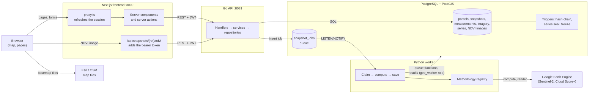
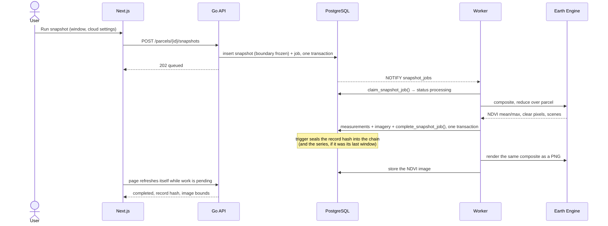
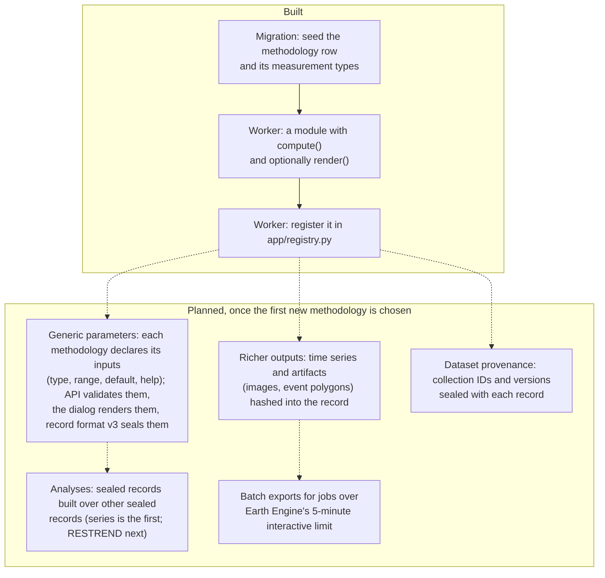

# Groundwork architecture

Diagrams are [Mermaid](https://mermaid.js.org/). GitHub renders them; in VS Code install
**Markdown Preview Mermaid Support** (`bierner.markdown-mermaid`) and open the Markdown preview.

## How the parts talk to each other

The Go API and the Python worker never call each other. PostgreSQL is the only link between
them, so either can be down or redeployed without breaking the other.

## Life of a snapshot

Failures go through `fail_snapshot_job()`: quota and network errors retry with backoff;
missing data or requests too big for Earth Engine fail at once with a readable reason.

## Adding a new analysis (methodology)

A methodology is a versioned, immutable recipe. Everything about a snapshot (inputs,
measurements, scenes) is sealed into its record hash, so a methodology never changes once
used: a change is a new version.

Today the cloud settings are NDVI-specific columns on `snapshots`; under the planned design
they become NDVI's declared parameters. Candidate methodologies from the agricultural
assessment idea: `chirps-rain-season`, `s2-phenology`, `water-history`, `drainage-baseline`,
`eudr-forest-check`.

## Sealed records at a glance

| Record | Sealed when | Hash covers |
|---|---|---|
| Snapshot (format v2) | It completes | Inputs incl. cloud settings, frozen boundary, every measurement and scene, previous record hash |
| Series (format v1) | Its last window completes or fails | Series settings and each window's record hash (or "failed"), in date order |

`verify_snapshot_chain()` recomputes every snapshot hash; `series_record_hash()` recomputes a series.
