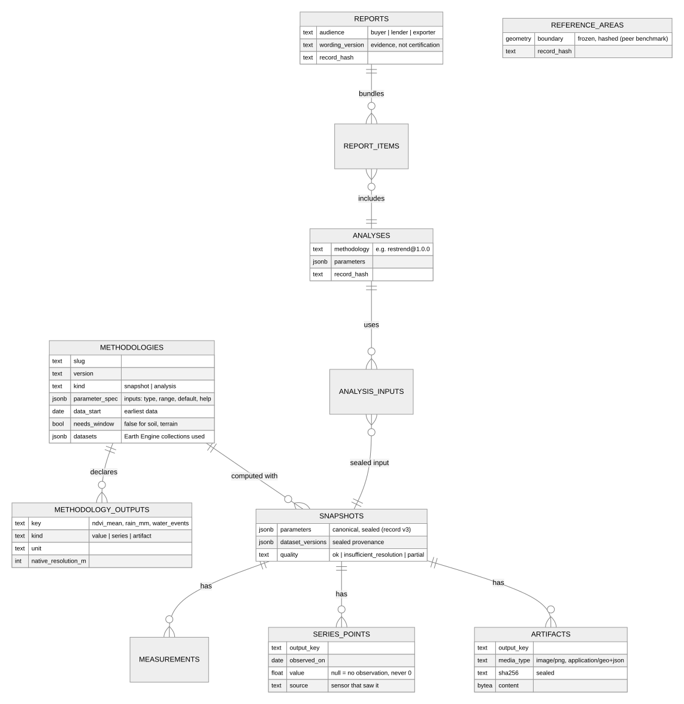
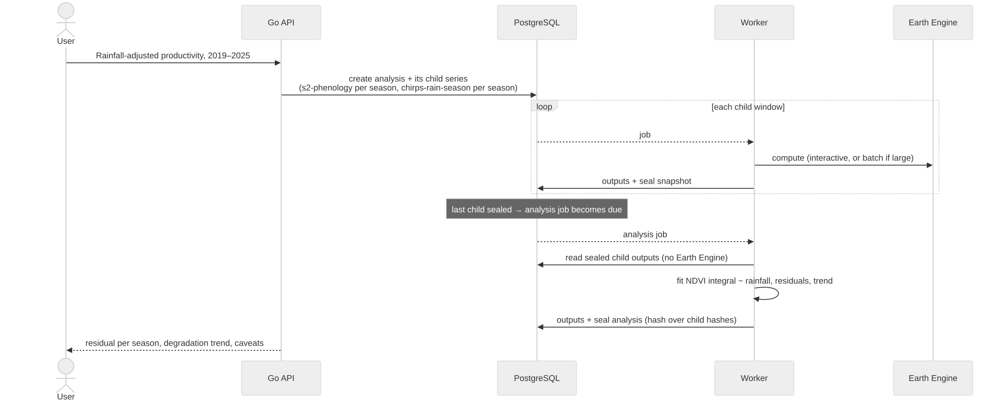

# Design: Groundwork as a multi-analysis platform (proposal)

Status: **proposal**, not built. Today's system is in [../architecture.md](../architecture.md).
Goal: add new analyses (rainfall, phenology, water history, terrain, EUDR...) without
touching the core each time, while every result stays sealed and reproducible.

The rule that doesn't change: **the Go API and the Python worker only meet in PostgreSQL.**

## 1. Components and how they talk

Source: [multi-analysis-1.mmd](../diagrams/multi-analysis-1.mmd)

Analysis plugins (like `restrend`) never call Earth Engine: they compute only from records
that are already sealed, so their inputs are fixed and checkable.

## 2. Layers of sealed evidence

Each layer's hash covers the hashes of the layer below, so a report can be checked all the
way down to individual satellite scenes.

Source: [multi-analysis-2.mmd](../diagrams/multi-analysis-2.mmd)

## 3. Data model (new and changed tables)

Source: [multi-analysis-3.mmd](../diagrams/multi-analysis-3.mmd)

Migration path: the current `max_scene_cloud_pct` / `cloud_score_threshold` columns become
NDVI's `parameters`; `snapshot_ndvi_images` becomes `artifacts`; existing records keep their
v1/v2 hash formats and still verify.

## 4. How a combined analysis runs (rainfall-adjusted productivity)

Source: [multi-analysis-4.mmd](../diagrams/multi-analysis-4.mmd)

## 5. The plugin contract

Source: [multi-analysis-5.mmd](../diagrams/multi-analysis-5.mmd)

- `parameter_spec` drives the API validation **and** the frontend form: one source of truth.
- `validate` enforces the minimum-pixel rule: a 9 km dataset on a 2 ha parcel returns
  `insufficient_resolution` instead of a number.
- `compute` may run interactively or start a batch export; the runner handles both.
- Missing observations are stored as null with the reason, never as 0.

## Build order

1. Plugin contract + parameter specs in `methodologies`; NDVI moved onto it (refactor, no behaviour change).
2. Generic `parameters`, dataset provenance, quality flags; record format v3.
3. `series_points` and `artifacts`; methodology-aware frontend views.
4. Second plugin, `chirps-rain-season`, end to end.
5. Prototype `water-history` and rainfall-adjusted residuals on parcels with known ground truth.
6. Analyses and batch exports; then reports with fixed, reviewed wording.
