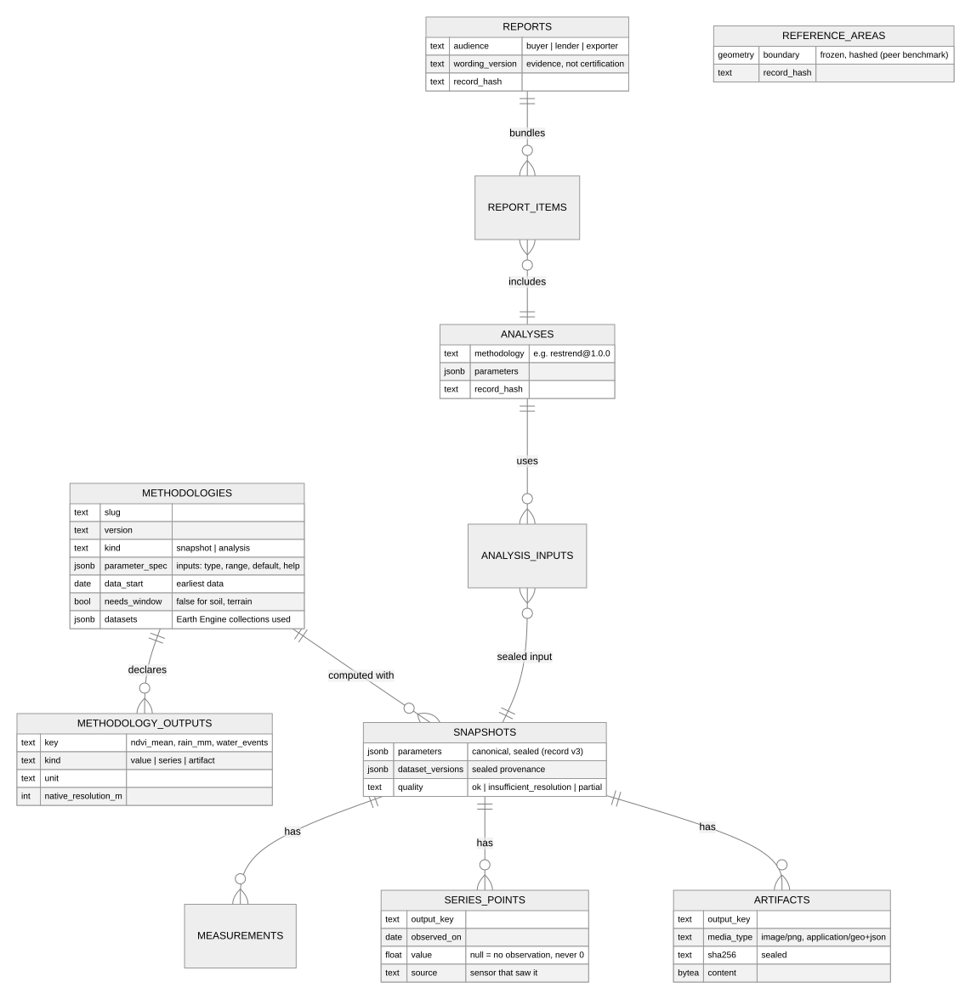
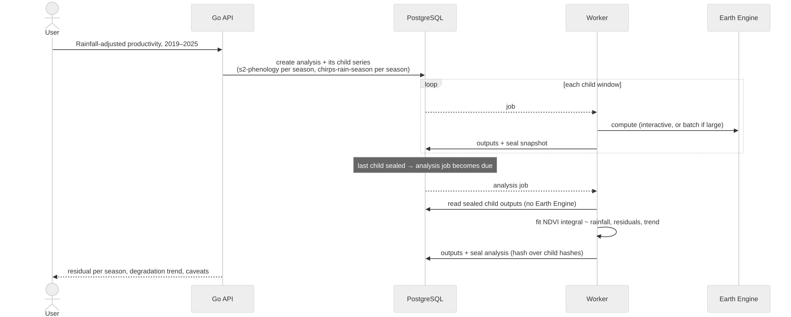

# Design: Groundwork as a multi-analysis platform

Status: **partly built.** Steps 1 and 2 of the [build order](#build-order) and the artifacts of step 3 are in place; the rest is a proposal. Today's system is in [../architecture.md](../architecture.md).
Goal: add new analyses (rainfall, phenology, water history, terrain, EUDR...) without
touching the core each time, while every result stays sealed and reproducible.

The rule that doesn't change: **the Go API and the Python worker only meet in PostgreSQL.**

## 1. Components and how they talk

Source: [multi-analysis-1.mmd](../diagrams/multi-analysis-1.mmd)

Analysis plugins (like `restrend`) never call Earth Engine: they compute only from records
that are already sealed, so their inputs are fixed and checkable.

## 2. Layers of sealed evidence

Each layer's hash covers the hashes of the layer below, so a report can be checked all the
way down to individual satellite scenes.

Source: [multi-analysis-2.mmd](../diagrams/multi-analysis-2.mmd)

## 3. Data model (new and changed tables)

Source: [multi-analysis-3.mmd](../diagrams/multi-analysis-3.mmd)

### Planned tables and columns

| Change | Replaces or adds |
|---|---|
| `methodologies`: `kind`, `data_start`, `needs_window`, `datasets` | Adds the plugin's declaration. Built: parameters live in `methodology_parameters` (migration 012), and the manifest hash is computed from them, not stored (migration 014) |
| `methodology_outputs` | Declared outputs: key, kind, unit, native resolution |
| `snapshots`: `quality` | Can be `insufficient_resolution`. Built: `parameters` and source versions (format v3), `code_version` (format v4); quality flags live in `snapshot_flags` |
| `series_points` | Dated values; a missing observation is null, never 0 |
| `artifacts` | Built (migration 016): replaces `snapshot_ndvi_images`, with media type and SHA-256, sealed in record format v5 |
| `analyses`, `analysis_inputs` | Sealed results built over other sealed records, e.g. RESTREND |
| `reports`, `report_items` | Bundles for buyers, lenders and exporters, worded as evidence, not certification |
| `reference_areas` | Frozen, hashed areas for peer benchmarks |
| Earth Engine batch exports | Jobs over the 5-minute limit for one request |

Migration path: the cloud columns already became NDVI's `parameters` (record format v3).
`snapshot_ndvi_images` became `artifacts` (format v5); the old table is dropped once no running
service reads it. Existing records keep the format they were sealed with and still verify.

## 4. How a combined analysis runs (rainfall-adjusted productivity)

Source: [multi-analysis-4.mmd](../diagrams/multi-analysis-4.mmd)

## 5. The plugin contract

Source: [multi-analysis-5.mmd](../diagrams/multi-analysis-5.mmd)

- The parameter spec drives the API validation **and** the frontend form: one source of truth.
  Built as `methodology_parameters`, checked against each plugin's manifest at worker startup.
- `validate` enforces the minimum-pixel rule: a 9 km dataset on a 2 ha parcel returns
  `insufficient_resolution` instead of a number.
- `compute` may run interactively or start a batch export; the runner handles both.
- Missing observations are stored as null with the reason, never as 0.

## Build order

1. ✅ Plugin contract + parameter specs; NDVI moved onto it (refactor, no behaviour change).
2. ✅ Generic `parameters`, dataset provenance, quality flags (record format v3); manifest hash and worker code version (format v4).
3. ✅ `artifacts` (record format v5). Remaining: `series_points`, methodology-aware frontend views.
4. Second plugin, `chirps-rain-season`, end to end.
5. Prototype `water-history` and rainfall-adjusted residuals on parcels with known ground truth.
6. Analyses and batch exports; then reports with fixed, reviewed wording.
